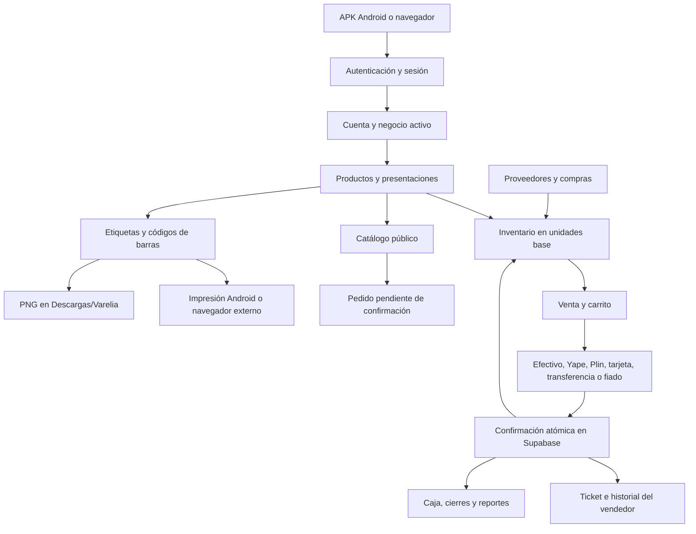

# Mapeo y simulación de Varelia

Fecha de revisión: 23 de octubre de 2026. Aplicación existente: https://vareliastore.tech.

## Mapa del funcionamiento

El stock de productos normales se controla en su unidad base. Una presentación de compra no cambia por sí sola la unidad de venta. Las presentaciones de venta multiplican el stock consumido: por ejemplo, un cajón de 36 unidades consume 36 unidades y medio cajón consume 18. Los pedidos públicos pendientes no son una venta cobrada ni deben interpretarse como dinero de caja.

## Módulos y pruebas

| Flujo | Archivos principales | Verificación |
|---|---|---|
| Inicio de sesión y recuperación | `supabase-auth.js`, `auth-session-state.js` | Botón Google en navegador simulado; restauración compartida; tokens vencidos; cierre de sesión |
| Cuenta y permisos | `supabase-auth.js`, `sellers.js`, políticas de Supabase | Aislamiento entre dos negocios; vendedor sin permisos; cambios de rol rechazados |
| Productos y costos | `index.html`, `product-form-safety.js`, `purchase-cost-math.js` | Costo 120/36; venta por unidad; presentaciones y costos independientes; guardado lento |
| Opciones y medicamentos | `characteristics.js`, `advanced-pricing.js`, `medicine-purchase-costs.js` | Caja, blíster y pastilla; metadatos internos; variantes y stock |
| Inventario y recepción | `central-stock-sync.js`, formulario de inventario | Entradas por cajón convertidas a unidades; cantidades fraccionarias; operación atómica |
| Proveedores y compras | `index.html`, RPC de compras | Creación y edición; ingreso de mercadería; reintentos sin duplicación; reversión de compra inválida |
| Venta, pagos y devoluciones | `pos-sales.js`, `payment-options.js`, RPC de venta y devolución | Confirmación única; prevención de sobreventa; devolución fraccionaria; crédito sin duplicación |
| Historial de vendedores | `sellers.js` | Calendario; límites del día; paginación; total completo; mixtos; fiado y pagos sin registrar |
| Tickets, caja y reportes | `pos-receipt.js`, `reports-profit.js`, `cash-consistency-fix.js` | Apertura de ticket; costos históricos; cierre confirmado por nube; reintento idempotente |
| Sincronización | `central-stock-sync.js`, `auth-session-state.js` | Conexión interrumpida; conservación de productos pendientes; estado conectado solo tras lectura correcta |
| Escaneo | `scanner-fix.js`, lector Android | Lecturas simuladas; imagen EAN-13 real generada; carrito estable; conservación del borrador de producto |
| Catálogo público | `catalogo/milagros/catalogo-v112.html` y `catalogo-base-v110.html` | Presentaciones; unidades; medicamentos; peso; variantes; pedido fallido; doble pulsación; carrito después del envío |
| Etiquetas | `barcode-tools.js`, `barcode-label-layout.js`, `imprimir-etiquetas.html` | A4/Carta; rollos; medidas incompatibles; tres copias/tres páginas; generador sin CDN; puente de impresión y navegador |
| Descarga PNG | `barcode-tools.js`, página externa de etiquetas | Archivo PNG válido de 1400×760; nombre; guardado Android solicitado; descarga de navegador real |

## Correcciones de esta revisión

1. **Escaneo sobre un producto abierto:** conserva nombre, precio y demás campos del borrador. La búsqueda opcional del nombre comercial ya no bloquea el formulario y tiene un límite por consulta.
2. **Cierre de sesión:** dos manejadores de la interfaz comparten una sola solicitud al SDK. Un error conserva la cuenta visible; un cierre confirmado limpia los datos visibles. Se elimina la redirección a `login.html`, que no existe en el proyecto.
3. **Stock del catálogo público:** se comprueban cantidades ya incluidas en el carrito al añadir unidades, medicamentos, peso y variantes. Los controles de incremento y la selección de peso no deben superar el stock disponible. El pedido se vuelve a validar antes de enviarlo.
4. **Confirmación de pedidos:** solo descuenta del carrito las líneas y cantidades enviadas. Los productos añadidos durante la espera permanecen guardados para otra compra.

5. **Recuperación del carrito público:** lee las selecciones guardadas antes del primer renderizado. El inicio ya no sobrescribe el carrito persistido con uno vacío.

## Cómo se simula sin modificar ventas reales

- `tests/purchase-cost.test.cjs` y `tests/seller-history.test.cjs`: cálculos, persistencia, sesión y asignación de pagos.
- `tests/browser-smoke.cjs`: interfaz móvil real en Chromium, con respuestas de red simuladas. No inicia sesión en cuentas reales ni registra ventas reales.
- `tests/public-catalog-smoke.cjs`: ejecuta el catálogo real con productos de prueba e intercepta todas las escrituras HTTP. Reproduce stock compartido y fallos de pedido.
- `tests/barcode-image.cjs`: usa el decodificador real sobre una imagen generada con el EAN-13 `7750670313537`; no simula una cámara física.
- `tests/database-release.sql`: 31 comprobaciones en la base de datos con usuarios y productos temporales. Toda la transacción termina en `ROLLBACK`; no conserva los datos de prueba.
- `.github/workflows/stability-audit.yml`: repite las comprobaciones de código y navegador en cada cambio de `main`.

## Estado de la revisión

La comprobación inicial de la base de datos pasó las 31 aserciones. Supabase respondió `ACTIVE_HEALTHY`. La validación de sintaxis y las pruebas locales de costos y pagos pasaron. Las pruebas ampliadas de navegador quedan registradas en GitHub Actions junto al commit de esta revisión; el informe debe leerse con el resultado de esa ejecución.

## Límites y observaciones pendientes

- El inicio de sesión Google se verifica con un proveedor simulado: no se ha completado un OAuth real con la cuenta del usuario durante esta auditoría.
- Cámara física, enfoque, reflejos, flash, permisos del teléfono, impresora Bluetooth, controlador y papel requieren una comprobación en el equipo real. Las simulaciones no certifican esas condiciones.
- La APK instalada antigua no tiene el puente nativo de impresión de etiquetas. Se conserva la vía de navegador externo, ya confirmada por el usuario. El PNG usa el puente de guardado existente.
- La APK de validación 1.0.53 compila, pero la firma original de la instalación sigue sin recuperarse. No se presenta como una actualización compatible ni se requiere desinstalar la aplicación para esta revisión web.
- Supabase informa advertencias de índices y políticas que conviene medir si crece el volumen. No se cambian permisos ni se eliminan índices solo por una sugerencia automática. Las funciones `SECURITY DEFINER` usadas por la aplicación deben comprobar su autorización; la prueba de roles cubre las operaciones principales, no una auditoría formal de cada función.
- La protección de contraseñas filtradas está desactivada en Auth. Referencia: [protección de contraseñas de Supabase](https://supabase.com/docs/guides/auth/password-security#password-strength-and-leaked-password-protection).
- Referencias de rendimiento: [índices de claves foráneas](https://supabase.com/docs/guides/database/database-linter?lint=0001_unindexed_foreign_keys), [evaluación de políticas por fila](https://supabase.com/docs/guides/database/postgres/row-level-security#call-functions-with-select).

Este informe delimita lo comprobado; no constituye una garantía de ausencia absoluta de errores.
